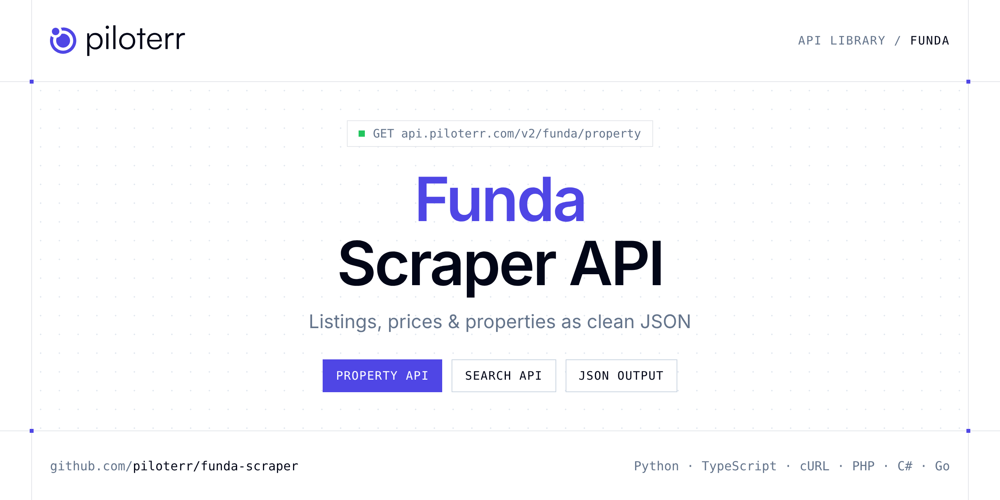

<p align="center">
  <a href="https://www.piloterr.com"></a>
</p>

# Funda Scraper API

[](https://discord.gg/CFj3ph8aHU) [](https://app.piloterr.com) [](https://app.piloterr.com/openapi) [](LICENSE)

The **Piloterr Funda Scraper API** lets you extract public data from Funda as **clean, structured JSON** — no proxies, headless browsers or HTML parsing to maintain. Endpoints available in production:

- **Funda Property API** — Read one Funda listing from its URL.
- **Funda Search API** — Search Funda by place.

Use it for property price monitoring, market analytics, investment sourcing or rental yield models.

| Endpoint | Path | Credits | What you get |
|---|---|---|---|
| [Funda Property API](#funda-property-api) | `/v2/funda/property` | 2 | Read one Funda listing from its URL. You get the asking price, living area, and the feature groups. |
| [Funda Search API](#funda-search-api) | `/v2/funda/search` | 2 | Search Funda by place. Set offering to koop for sale or huur for rent, then page the listings. |

## Table of contents

- [How it works](#how-it-works)
- [Funda Property API](#funda-property-api)
- [Funda Search API](#funda-search-api)
- [Code examples in other languages](#code-examples-in-other-languages)
- [Practical use cases](#practical-use-cases)
- [Why Piloterr?](#why-piloterr)
- [FAQ](#faq)
- [Related scrapers](#related-scrapers)
- [Support](#support)

## How it works

1. **Create a free Piloterr account** and copy your API key from the [dashboard](https://app.piloterr.com).
2. **Send a `GET` (or `POST`) request** to `https://api.piloterr.com/v2/...` with the header `x-api-key: YOUR_API_KEY`.
3. **Receive structured JSON** — Piloterr handles rendering, proxies, retries and parsing.

```bash
export PILOTERR_API_KEY="your-api-key"
pip install requests        # Python
# TypeScript: Node.js 18+ (native fetch), run with `npx tsx file.ts`
```

> Every endpoint accepts both `GET` (query string) and `POST` (JSON body with the same fields).

## Funda Property API

Read one Funda listing from its URL. You get the asking price, living area, and the feature groups.

`GET | POST https://api.piloterr.com/v2/funda/property` · **2 credits per request** · [Full reference](https://app.piloterr.com/openapi)

### Request parameters

| Parameter | Type | Required | Description |
|---|---|---|---|
| `query` | string | ✅ | Listing URL on www.funda.nl, under /detail/koop or /detail/huur. |

### Python example

```python
import json
import os
import requests

response = requests.get(
    "https://api.piloterr.com/v2/funda/property",
    headers={"x-api-key": os.environ["PILOTERR_API_KEY"]},
    params={
        "query": "https://www.funda.nl/detail/koop/amsterdam/appartement-hillegomstraat-57-1/44654106/",
    },
    timeout=120,
)
response.raise_for_status()
data = response.json()

print(json.dumps(data, indent=2, ensure_ascii=False)[:2000])
```

### TypeScript example

```typescript
type FundaProperty = {
  id?: number;
  url?: string;
  city?: string;
  price?: number;
  title?: string;
  labels?: {
    text?: string;
    type?: string;
  }[];
  photos?: string[];
  videos?: string[];
  country?: string;
  bedrooms?: number;
  currency?: string;
  features?: {
    id?: string;
    items?: {
      id?: string;
      label?: string;
      value?: string;
    }[];
    title?: string;
  }[];
  latitude?: number;
  province?: string;
  subtitle?: string;
  global_id?: number;
  longitude?: number;
  highlights?: {
    title?: string;
    category?: string;
    description?: string;
  }[];
  is_auction?: boolean;
  photos_360?: string[];
  promo_text?: string;
  description?: string;
  floor_plans?: string[];
  living_area?: number;
  object_type?: string;
  [key: string]: unknown;
};

const params = new URLSearchParams({
  "query": "https://www.funda.nl/detail/koop/amsterdam/appartement-hillegomstraat-57-1/44654106/",
});

const response = await fetch(`https://api.piloterr.com/v2/funda/property?${params}`, {
  headers: { "x-api-key": process.env.PILOTERR_API_KEY! },
});
if (!response.ok) throw new Error(`Piloterr error ${response.status}: ${await response.text()}`);

const data = (await response.json()) as FundaProperty;

console.log(JSON.stringify(data, null, 2).slice(0, 2000));
```

<details>
<summary><b>POST variant</b></summary>

```http
POST https://api.piloterr.com/v2/funda/property
x-api-key: YOUR_API_KEY
Content-Type: application/json

{"query": "https://www.funda.nl/detail/koop/amsterdam/appartement-hillegomstraat-57-1/44654106/"}
```
</details>

### Output example

Example response from the API reference, abridged — real values depend on the page you scrape.

```json
{
  "id": 44654106,
  "url": "https://www.funda.nl/detail/koop/amsterdam/appartement-hillegomstraat-57-1/44654106/",
  "city": "Amsterdam",
  "price": 565000,
  "title": "Hillegomstraat 57-1",
  "labels": [
    {
      "text": "Nieuw",
      "type": "new"
    }
  ],
  "photos": [
    "https://cloud.funda.nl/valentina_media/237/101/037.jpg",
    "https://cloud.funda.nl/valentina_media/237/101/216.jpg"
  ],
  "videos": [
    "https://customer-vzk8jgcsaz84e8sb.cloudflarestream.com/5a5905ba200a2d987d171f80afdd948c/manifest/video.m3u8"
  ],
  "country": "Nederland",
  "bedrooms": 2,
  "currency": "EUR",
  "features": [
    {
      "id": "overdracht",
      "items": [
        {},
        {}
      ],
      "title": "Overdracht"
    },
    {
      "id": "bouw",
      "items": [
        {},
        {}
      ],
      "title": "Bouw"
    }
  ],
  "latitude": 52.352062,
  "province": "Noord-Holland",
  "subtitle": "1058 LR Amsterdam",
  "global_id": 8209743,
  "longitude": 4.846501,
  "highlights": [
    {
      "title": "Zonnig verdiept balkon",
      "category": "outdoor_space_and_views",
      "description": "Balkon van circa 14 m² op het zuiden met groen uitzicht."
    },
    {
      "title": "Ruime vernieuwde woonkeuken",
      "category": "kitchen_and_living",
      "description": "Recent vernieuwde woonkeuken met plek voor grote eettafel."
    }
  ],
  "is_auction": false,
  "photos_360": [
    "https://cloud.funda.nl/listing-management/e3ae662c-5ce0-4952-b3c5-eda8703c5543",
    "https://cloud.funda.nl/listing-management/800b9f03-2cee-4b44-b1a7-286c2e3e1f87"
  ],
  "promo_text": "Sfeervol appartement met verdiept balkon in de Hoofdorppleinbuurt!",
  "description": "In een van de mooiste straten van de geliefde Hoofddorppleinbuurt ligt dit lichte en sfeervolle driekamerappartement van circa 60 m², met…",
  "floor_plans": [
    "https://cloud.funda.nl/listing-management/0008624c-4bac-4051-b047-6afa4c941642"
  ],
  "living_area": 60,
  "object_type": "apartment"
}
```

### Response fields

| Field | Type | Description |
|---|---|---|
| `id` | integer |  |
| `url` | string |  |
| `city` | string |  |
| `price` | integer |  |
| `title` | string |  |
| `labels[]` | object[] |  |
| `labels[].text` | string |  |
| `labels[].type` | string |  |
| `photos` | string[] |  |
| `videos` | string[] |  |
| `country` | string |  |
| `bedrooms` | integer |  |
| `currency` | string |  |
| `features[]` | object[] |  |
| `features[].id` | string |  |
| `features[].items[]` | object[] |  |
| `features[].title` | string |  |
| `latitude` | number |  |
| `province` | string |  |
| `subtitle` | string |  |
| `global_id` | integer |  |
| `longitude` | number |  |
| `highlights[]` | object[] |  |
| `highlights[].title` | string |  |
| `highlights[].category` | string |  |

## Funda Search API

Search Funda by place. Set offering to koop for sale or huur for rent, then page the listings.

`GET | POST https://api.piloterr.com/v2/funda/search` · **2 credits per request** · [Full reference](https://app.piloterr.com/openapi)

### Request parameters

| Parameter | Type | Required | Description |
|---|---|---|---|
| `query` | string | ✅ | City, area, or a Funda search URL. |
| `offering` | string | — | Sale or rent when query is a place. |
| `page` | number | — | Page from 1. Example: 2. Funda receives this as search_result=2. Page 1 and page 2 return different listings. |

### Python example

```python
import json
import os
import requests

response = requests.get(
    "https://api.piloterr.com/v2/funda/search",
    headers={"x-api-key": os.environ["PILOTERR_API_KEY"]},
    params={
        "query": "amsterdam",
    },
    timeout=120,
)
response.raise_for_status()
data = response.json()

print(json.dumps(data, indent=2, ensure_ascii=False)[:2000])
```

### TypeScript example

```typescript
type FundaSearch = {
  results?: {
    id?: number;
    url?: string;
    city?: string;
    agent?: {
      id?: number;
      url?: string;
      logo?: string;
      name?: string;
      association?: string;
      contact_name?: unknown;
      contact_image?: unknown;
    };
    image?: string;
    price?: number;
    rooms?: number;
    title?: string;
    images?: string[];
    street?: string;
    zoning?: string;
    country?: string;
    bedrooms?: number;
    currency?: string;
    district?: string;
    province?: string;
    global_id?: number;
    plot_area?: unknown;
    floor_area?: number;
    price_type?: string;
    promo_text?: string;
    media_types?: string[];
    object_type?: string;
    postal_code?: string;
    energy_label?: string;
    [key: string]: unknown;
  }[];
  pagination?: {
    next?: string;
    page?: number;
    per_page?: number;
    total_pages?: number;
    total_results?: number;
  };
};

const params = new URLSearchParams({
  "query": "amsterdam",
});

const response = await fetch(`https://api.piloterr.com/v2/funda/search?${params}`, {
  headers: { "x-api-key": process.env.PILOTERR_API_KEY! },
});
if (!response.ok) throw new Error(`Piloterr error ${response.status}: ${await response.text()}`);

const data = (await response.json()) as FundaSearch;

console.log(JSON.stringify(data, null, 2).slice(0, 2000));
```

<details>
<summary><b>POST variant</b></summary>

```http
POST https://api.piloterr.com/v2/funda/search
x-api-key: YOUR_API_KEY
Content-Type: application/json

{"query": "amsterdam"}
```
</details>

### Output example

Example response from the API reference, abridged — real values depend on the page you scrape.

```json
{
  "results": [
    {
      "id": 44654106,
      "url": "https://www.funda.nl/detail/koop/amsterdam/appartement-hillegomstraat-57-1/44654106/",
      "city": "Amsterdam",
      "agent": {
        "id": 0,
        "url": "example",
        "logo": "example",
        "name": "example",
        "association": "example",
        "contact_name": null,
        "contact_image": null
      },
      "image": "https://cloud.funda.nl/tiara-media/4d4baf74-f6c7-4d23-85d6-7a031ab7b45c/fccdebc5-cc6a-477e-97e2-32651664f739?options=width=720",
      "price": 565000,
      "rooms": 3,
      "title": "Hillegomstraat 57-1",
      "images": [
        "https://cloud.funda.nl/tiara-media/4d4baf74-f6c7-4d23-85d6-7a031ab7b45c/fccdebc5-cc6a-477e-97e2-32651664f739?options=width=720",
        "https://cloud.funda.nl/tiara-media/4d4baf74-f6c7-4d23-85d6-7a031ab7b45c/fdb09cc2-b7a5-48d9-9243-455de8545155?options=width=720"
      ],
      "street": "Hillegomstraat",
      "zoning": "residential",
      "country": "NL",
      "bedrooms": 2,
      "currency": "EUR",
      "district": "Hoofddorppleinbuurt",
      "province": "Noord-Holland",
      "global_id": 8209743,
      "plot_area": null,
      "floor_area": 60,
      "price_type": "regular",
      "promo_text": "Sfeervol appartement met verdiept balkon in de Hoofdorppleinbuurt!",
      "media_types": [
        "floor_plan",
        "photo_360"
      ],
      "object_type": "apartment",
      "postal_code": "1058 LR",
      "energy_label": "D"
    }
  ],
  "pagination": {
    "next": "https://www.funda.nl/zoeken/koop/?selected_area=amsterdam&search_result=2",
    "page": 1,
    "per_page": 15,
    "total_pages": 467,
    "total_results": 7003
  }
}
```

### Response fields

| Field | Type | Description |
|---|---|---|
| `results[]` | object[] |  |
| `results[].id` | integer |  |
| `results[].url` | string |  |
| `results[].city` | string |  |
| `results[].agent` | object |  |
| `results[].image` | string |  |
| `results[].price` | integer |  |
| `results[].rooms` | integer |  |
| `results[].title` | string |  |
| `results[].images` | string[] |  |
| `results[].street` | string |  |
| `results[].zoning` | string |  |
| `results[].country` | string |  |
| `results[].bedrooms` | integer |  |
| `results[].currency` | string |  |
| `results[].district` | string |  |
| `results[].province` | string |  |
| `results[].global_id` | integer |  |
| `results[].plot_area` | object |  |
| `results[].floor_area` | integer |  |
| `results[].price_type` | string |  |
| `results[].promo_text` | string |  |
| `results[].media_types` | string[] |  |
| `results[].object_type` | string |  |
| `results[].postal_code` | string |  |

## Code examples in other languages

Ready-to-run examples live in the [`examples/`](examples) folder. Each one reads your key from the `PILOTERR_API_KEY` environment variable.

| Language | Property | Search |
|---|---|---|
| cURL (Bash) | [`property`](examples/curl/property.sh) | [`search`](examples/curl/search.sh) |
| PHP | [`property`](examples/php/property.php) | [`search`](examples/php/search.php) |
| C# | [`property`](examples/csharp/Property.cs) | [`search`](examples/csharp/Search.cs) |
| Go | [`property`](examples/go/property.go) | [`search`](examples/go/search.go) |
| Java | [`property`](examples/java/PropertyExample.java) | [`search`](examples/java/SearchExample.java) |
| Ruby | [`property`](examples/ruby/property.rb) | [`search`](examples/ruby/search.rb) |
| Node.js | [`property`](examples/nodejs/property.mjs) | [`search`](examples/nodejs/search.mjs) |

## Practical use cases

- **Price monitoring** — Track asking prices and price drops per area.
- **Market analytics** — Measure inventory, days on market and price per m² / sqft.
- **Investment sourcing** — Detect undervalued properties as soon as they are listed.
- **Rental yield models** — Combine sale and rent listings to estimate yields.
- **Proptech products** — Power portals, valuation tools and alerts with structured listings.

## Why Piloterr?

- **No infrastructure** — no proxies, headless browsers or CAPTCHA solving to run yourself.
- **Structured JSON** — stable, documented fields instead of brittle HTML selectors.
- **Pay per request** — transparent credit cost per endpoint, failed requests are retried for you.
- **One API key, hundreds of sources** — Funda plus many other e-commerce, search and company data endpoints in the [Piloterr library](https://www.piloterr.com/library).
- **Any language** — plain HTTPS + JSON, with examples for Python, TypeScript, cURL, PHP, C#, Go, Java, Ruby and Node.js.

## FAQ

### Is it legal to scrape Funda?

Collecting publicly available data is generally allowed in many jurisdictions, but rules depend on your country, the data you collect and how you use it. Avoid personal data unless you have a lawful basis, respect the website's terms where they apply, and get legal advice for your specific use case. This is not legal advice.

### Do I need proxies or a headless browser?

No. Piloterr handles rendering, proxy rotation and retries on its side. You only send an HTTPS request with your `x-api-key` header and receive JSON.

### How much does a request cost?

Credits per call: `/v2/funda/property` **2**, `/v2/funda/search` **2**. See the [Piloterr website](https://www.piloterr.com) for plans.

### What data does the Funda API return?

Each endpoint returns structured JSON: **Funda Property** — `id`, `url`, `city`, `price`, `title`, `labels[]`; **Funda Search** — `results[]`, `results[].id`, `results[].url`, `results[].city`, `results[].agent`, `results[].image`.

### How do I paginate Funda results?

Use the `page` parameter and keep requesting while the response indicates more results.

### Which languages are supported?

Any language that can make an HTTP request. This README shows Python and TypeScript; the [`examples/`](examples) folder contains cURL, PHP, C#, Go, Java, Ruby and Node.js.

## Related scrapers

- [Apartments Scraper API](https://github.com/piloterr/apartments-scraper)
- [Argenprop Scraper API](https://github.com/piloterr/argenprop-scraper)
- [Centris Scraper API](https://github.com/piloterr/centris-scraper)
- [Fotocasa Scraper API](https://github.com/piloterr/fotocasa-scraper)
- [Homestra Scraper API](https://github.com/piloterr/homestra-scraper)
- [Idealista Scraper API](https://github.com/piloterr/idealista-scraper)
- [All Piloterr scrapers on GitHub](https://github.com/piloterr)

## Support

- 💬 Join the [Piloterr Discord](https://discord.gg/CFj3ph8aHU) to ask questions and share what you build.
- 📚 Browse the [API reference (OpenAPI)](https://app.piloterr.com/openapi) and the [Piloterr library](https://www.piloterr.com/library).
- 🔑 [Get your API key](https://app.piloterr.com).

---

<p align="center">
  <a href="https://www.piloterr.com">
    <picture>
      <source media="(prefers-color-scheme: dark)" srcset="images/logo-dark.svg">
      
    </picture>
  </a>
  <br>
  <sub>Built by <a href="https://www.piloterr.com">Piloterr</a> — web scraping APIs for e-commerce, search, real estate and more, one API key.</sub>
</p>

<sub>Funda is a trademark of its respective owner. This repository is not affiliated with or endorsed by Funda. Examples are released under the MIT license.</sub>
